# 🦋 FalterKataster

**Insekten-Funddaten mit Fundort- und Art-Katalog – als einzelne HTML-Datei, direkt im Browser.**

FalterKataster ist eine Anwendung zur Erfassung, Verwaltung und Auswertung von Schmetterlings- und Nachtfalter-Beobachtungen. Die gesamte Anwendung steckt in einer einzigen Datei (`fundkataster.html`). Es gibt keinen Server, keine Installation und kein Benutzerkonto: Datei öffnen, loslaufen.

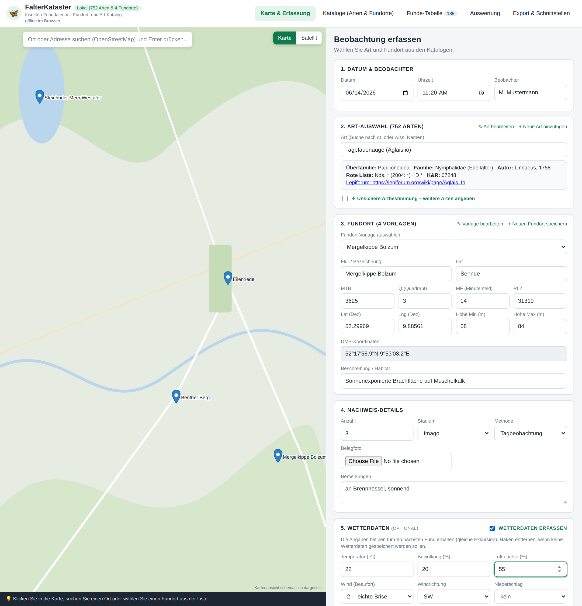

> **Hinweis zu den Bildern:** Alle Screenshots entstanden mit **Demodaten** (erfundene Beispielfunde, Beobachter „M. Mustermann“). Die Kartenflächen sind **schematisch** dargestellt, weil die Screenshots ohne Internetzugang erzeugt wurden. In der echten Anwendung zeigt die Karte OpenStreetMap-Kacheln bzw. Satellitenbilder.

---

## Inhaltsverzeichnis

1. [Überblick](#überblick)
2. [Schnellstart](#schnellstart)
3. [Karte & Erfassung](#1-karte--erfassung)
4. [Kataloge (Arten & Fundorte)](#2-kataloge-arten--fundorte)
5. [Funde-Tabelle](#3-funde-tabelle)
6. [Auswertung](#4-auswertung)
7. [Fundbericht (PDF / Word)](#5-fundbericht-pdf--word)
8. [Sammlungsetiketten drucken](#6-sammlungsetiketten-drucken)
9. [Export & Schnittstellen](#7-export--schnittstellen)
10. [Datenformate für den Import](#datenformate-für-den-import)
11. [Datenspeicherung & Datensicherheit](#datenspeicherung--datensicherheit)
12. [Technische Hinweise](#technische-hinweise)

---

## Überblick

| Bereich | Was du damit machst |
|---|---|
| **Karte & Erfassung** | Neue Beobachtungen aufnehmen: Datum, Art, Fundort per Kartenklick, Details, Wetter, Foto |
| **Kataloge** | Artenliste (752 Arten mitgeliefert) und Fundort-Vorlagen verwalten, importieren, exportieren |
| **Funde-Tabelle** | Alle Funde durchsuchen, bearbeiten, löschen und für den Etikettendruck auswählen |
| **Auswertung** | Fundkarte und Phänologie-Diagramm (Nachweise je Kalenderwoche), Fundbericht als PDF/Word |
| **Export & Schnittstellen** | Excel, CSV und JSON ex- und importieren, Backup, automatische Dateiablage |

**Highlights auf einen Blick**

- Artenauswahl per Suche nach deutschem **oder** wissenschaftlichem Namen, mit Familie, Autor, **Roter Liste** (Niedersachsen und Deutschland), K&R-Nummer und Link zum Lepiforum
- **Automatische Berechnung von MTB, Quadrant und Minutenfeld** (TK25-Raster) aus den Koordinaten
- Fundorte als wiederverwendbare **Vorlagen**
- **Unsichere Artbestimmung** mit bis zu 10 Alternativarten
- Optionale **Wetterdaten** pro Fund (inklusive Beaufort-Skala und Mondphase)
- **Belegfotos** direkt am Fund
- **Sammlungsetiketten** in frei einstellbarer Größe drucken
- **Fundberichte** als PDF oder Word-Datei
- Auswertungen als **PNG** exportierbar
- Alle Daten bleiben **lokal im Browser** – optional zusätzlich automatisch in einer Datei auf der Festplatte

---

## Schnellstart

1. `fundkataster.html` in **Microsoft Edge** oder **Google Chrome** öffnen (für die automatische Dateiablage nötig, siehe [Datenordner](#datenspeicherung--datensicherheit)).
2. Optional unter **Kataloge** eigene Fundorte importieren oder später direkt bei der Erfassung anlegen.
3. Unter **Karte & Erfassung** Datum, Art und Fundort wählen und auf **Beobachtung speichern** klicken.
4. Unter **Auswertung** die Funde auf der Karte und im Jahresverlauf ansehen.
5. Regelmäßig unter **Export & Schnittstellen** ein **Backup** erzeugen oder einen **Datenordner verbinden**.

Die Kopfzeile zeigt dauerhaft, wie viele Arten und Fundorte geladen sind (z. B. *Lokal (752 Arten & 4 Fundorte)*). Der Zähler am Tab **Funde-Tabelle** zeigt die Anzahl der erfassten Funde.

---

## 1. Karte & Erfassung

Links die Karte, rechts das Erfassungsformular in fünf Abschnitten.

### Die Karte

- **Klick in die Karte** setzt den Fundpunkt. Breite, Länge, DMS-Koordinaten sowie MTB/Q/MF werden sofort ausgefüllt.
- **Ortssuche** oben links: Ortsnamen oder Adresse eingeben und Enter drücken. Die Suche nutzt OpenStreetMap-Daten (Photon, mit Nominatim als Rückfalllösung). Ein Treffer setzt den Punkt, zoomt die Karte heran und übernimmt den Ortsnamen als Fundort-Bezeichnung, sofern das Feld noch leer ist.
- **Umschalter Karte / Satellit** oben rechts: Wechselt zwischen Straßenkarte und Satellitenbild (Esri World Imagery mit Ortsnamen). Die Wahl wird gemerkt und gilt auch in der Auswertung.
- **Ausfallsicherheit:** Sind Kartenserver im Netzwerk blockiert, wechselt die Anwendung automatisch auf alternative Kachelanbieter. Ist keiner erreichbar, bleibt die Eingabe der Koordinaten von Hand möglich.

### 1. Datum & Beobachter

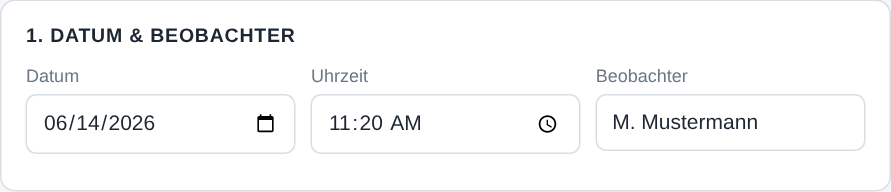

Datum und Uhrzeit sind mit dem aktuellen Zeitpunkt vorbelegt. Der **Beobachtername bleibt nach dem Speichern erhalten**, damit er bei mehreren Funden nacheinander nicht neu getippt werden muss.

### 2. Art-Auswahl

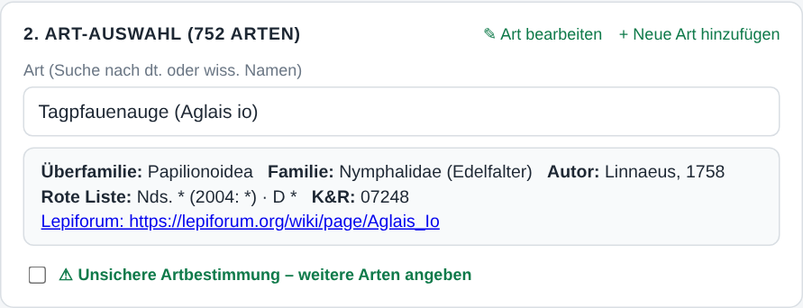

- Tippen sucht im Katalog nach **deutschem oder wissenschaftlichem Namen**.
- Nach der Auswahl erscheint eine **Infobox** mit Überfamilie, Familie, Autor, Rote-Liste-Status (Niedersachsen aktuell und 2004, Deutschland), K&R-Nummer und einem **Link zum Lepiforum**.
- **✎ Art bearbeiten** und **+ Neue Art hinzufügen** öffnen den Art-Dialog, ohne die Erfassung zu verlassen.
- Eine Beobachtung kann nur gespeichert werden, wenn die Art aus dem Katalog stammt. Fehlt sie, wird sie zuerst über *Neue Art hinzufügen* angelegt.

#### Unsichere Artbestimmung

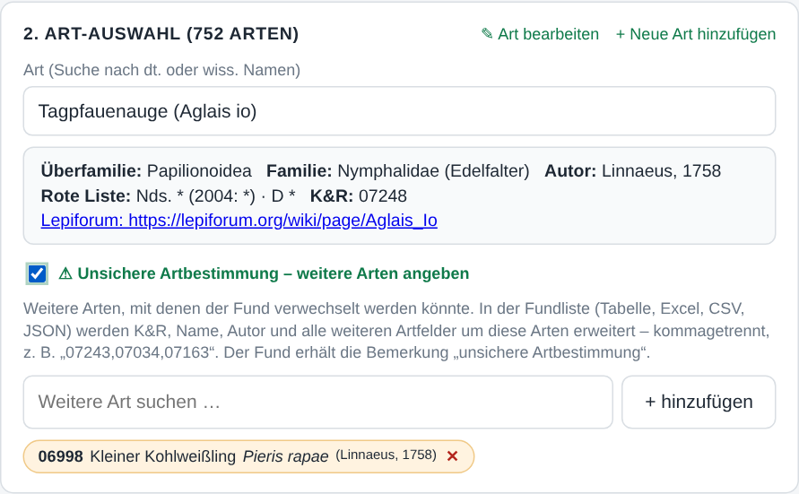

Ist die Bestimmung nicht eindeutig, aktivierst du **⚠ Unsichere Artbestimmung** und gibst **weitere in Frage kommende Arten** an (bis zu 10, jede als entfernbarer Chip).

- Der Fund erhält automatisch die Bemerkung *„unsichere Artbestimmung“*.
- In der Funde-Tabelle, in Excel, CSV und JSON werden K&R-Nummer, Name, Autor und alle weiteren Artfelder um die Alternativarten ergänzt.
- Im Fundbericht erscheinen beide Arten mit dem Vermerk *unsichere Artbestimmung*.

### 3. Fundort

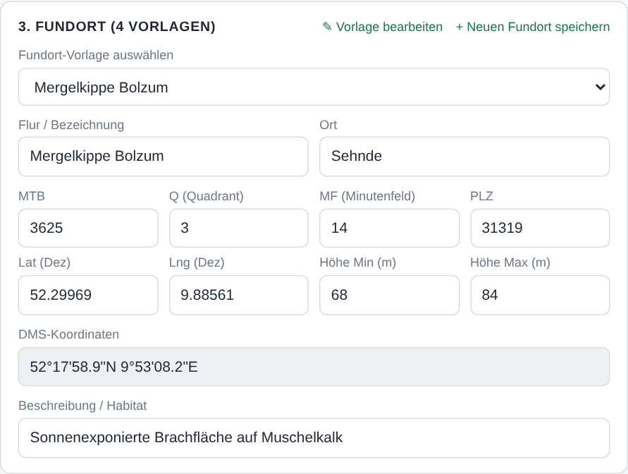

- Mit **Fundort-Vorlage auswählen** füllst du alle Felder auf einmal aus einem gespeicherten Fundort und setzt den Marker auf der Karte.
- **Felder:** Flur/Bezeichnung, Ort, MTB, Q (Quadrant 1–4), MF (Minutenfeld 1–15), PLZ, Breite/Länge (dezimal), Höhe min./max. und Beschreibung/Habitat.
- **MTB / Q / MF werden automatisch berechnet**, sobald Koordinaten vorliegen (TK25-Raster, Bezug DHDN). Ein Hinweis unter den Feldern bestätigt die Berechnung. Liegt die Position außerhalb Deutschlands, wird um manuelle Eingabe gebeten.
- Die **DMS-Anzeige** (z. B. `52°17'58.9"N 9°53'08.2"E`) wird live aus den Dezimalwerten erzeugt.
- **+ Neuen Fundort speichern** legt die aktuellen Angaben als Vorlage an. Gleichnamige Fundorte werden abgelehnt, bestehende lassen sich über **✎ Vorlage bearbeiten** ändern.

### 4. Nachweis-Details

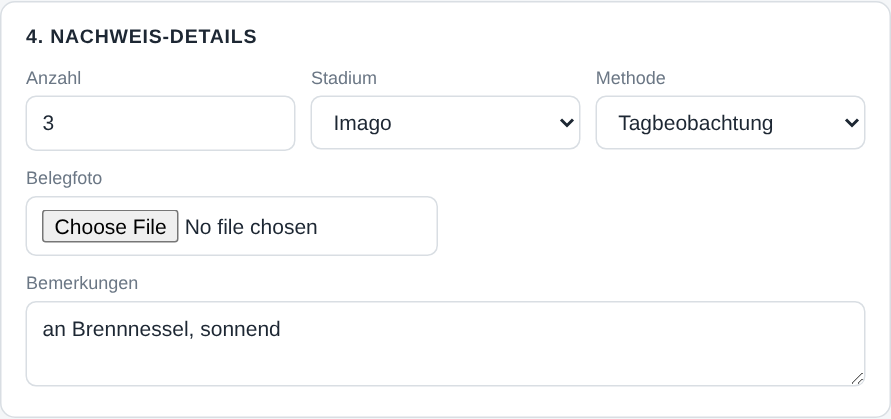

| Feld | Auswahl |
|---|---|
| **Anzahl** | Zahl der Individuen (Standard 1) |
| **Stadium** | Imago, Ei, Raupe/Larve, Puppe, Exuvie, Fraßspur |
| **Methode** | Tagbeobachtung, Lichtfang, Köderfang, Kescher/Fang, Aufzucht, Sonstiges |
| **Belegfoto** | Bilddatei, wird automatisch auf maximal 900 Pixel Kantenlänge verkleinert und als JPEG gespeichert |
| **Bemerkungen** | Freitext zu Verhalten, Futterpflanze, Begleitumständen |

### 5. Wetterdaten (optional)

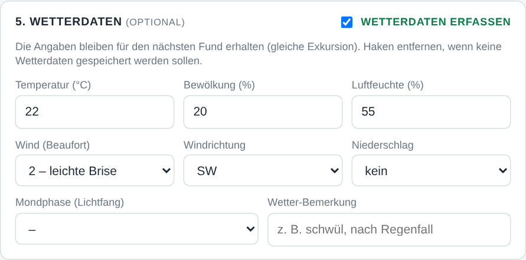

Mit dem Schalter **Wetterdaten erfassen** werden folgende Angaben zum Fund gespeichert:

- Temperatur (°C), Bewölkung (%), Luftfeuchte (%)
- **Wind nach Beaufort** (0 – Windstill bis 12 – Orkan) und Windrichtung (N, NO, O, SO, S, SW, W, NW)
- Niederschlag (kein, Nieselregen, Regen, Schauer, Gewitter, Schnee/Graupel)
- Mondphase für den Lichtfang (Neumond, zunehmend, Vollmond, abnehmend)
- Freie Wetter-Bemerkung

Die Werte **bleiben für den nächsten Fund erhalten**, weil sie meist für die gesamte Exkursion gelten. Wird der Haken entfernt, werden keine Wetterdaten gespeichert.

### Speichern

- **Beobachtung speichern** legt den Fund ab und leert das Formular (Beobachtername bleibt).
- **Formular leeren** setzt alle Felder inklusive Wetterdaten zurück.
- Pflichtangaben: eine Art aus dem Katalog sowie ein Fundort (Karte, Vorlage, Flur-Bezeichnung oder MTB).

---

## 2. Kataloge (Arten & Fundorte)

Der Tab **Kataloge** verwaltet die beiden Stammdatenlisten, aus denen die Erfassung schöpft.

### Artenkatalog

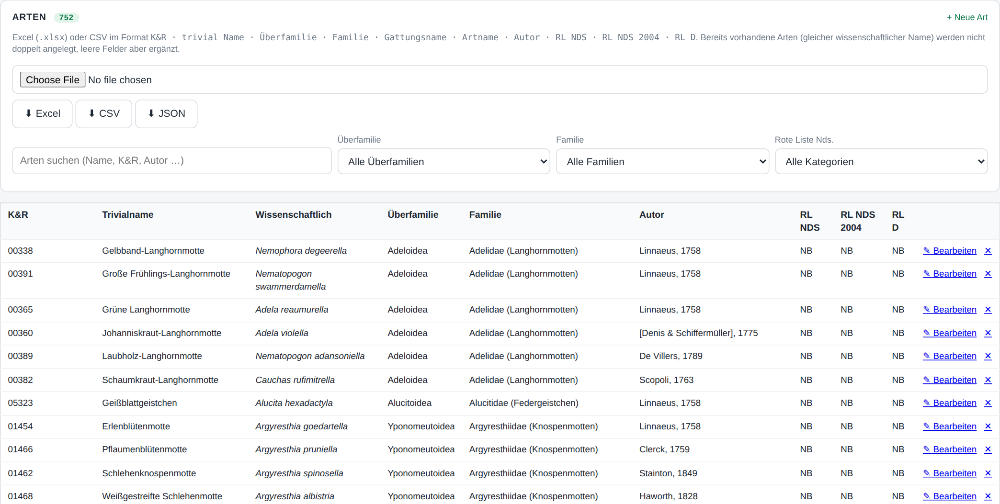

- **752 Arten** (56 Familien) sind bereits mitgeliefert, mit K&R-Nummer, Trivialname, Überfamilie, Familie, Gattung, Art, Autor und Rote-Liste-Einstufungen (Niedersachsen, Niedersachsen 2004, Deutschland).
- **Suchen und Filtern:** Freitextsuche über Namen, K&R und Autor, dazu Dropdowns für **Überfamilie**, **Familie** und **Rote Liste Nds.**
- **Bearbeiten und Löschen** pro Zeile (Löschen mit Rückfrage).
- **+ Neue Art:** Öffnet den Dialog (siehe unten).
- **Import** von Excel (`.xlsx`, `.xls`), CSV, TXT oder JSON. Bereits vorhandene Arten (gleicher wissenschaftlicher Name) werden **nicht doppelt angelegt**, leere Felder aber ergänzt.
- **Export** als Excel, CSV oder JSON im selben Spaltenformat wie der Import.

#### Art bearbeiten / neu anlegen

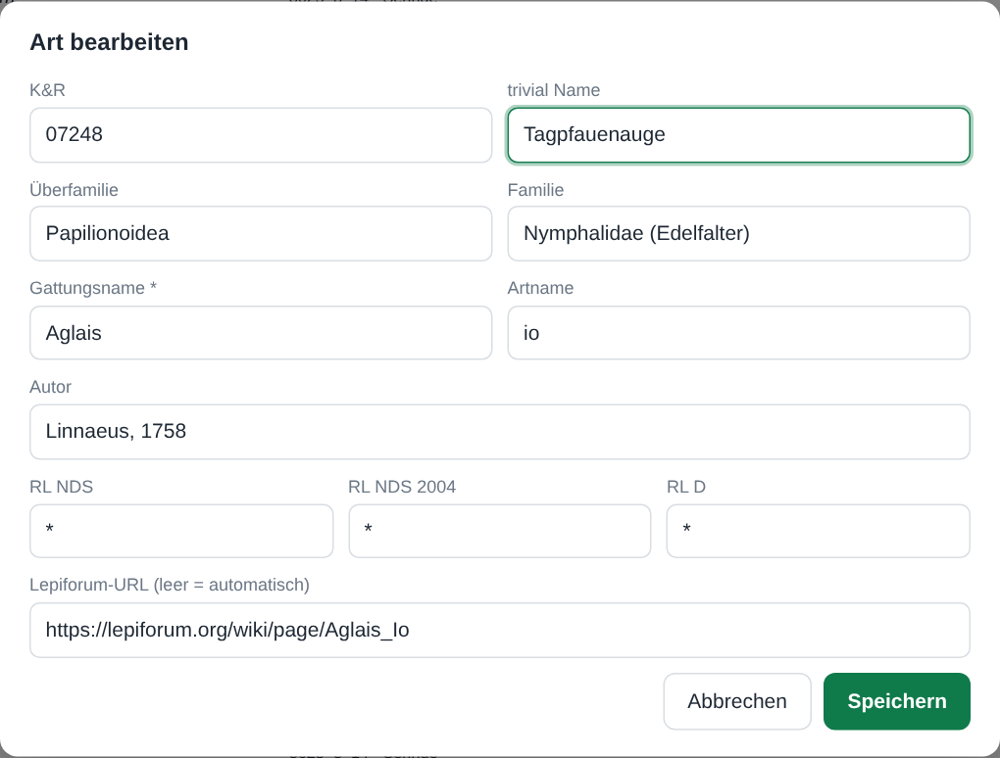

Alle Katalogfelder sind editierbar. Das Feld **Lepiforum-URL** kann leer bleiben, dann wird der Link automatisch aus dem wissenschaftlichen Namen gebildet. Pflichtfeld ist der Gattungsname.

### Fundort-Katalog

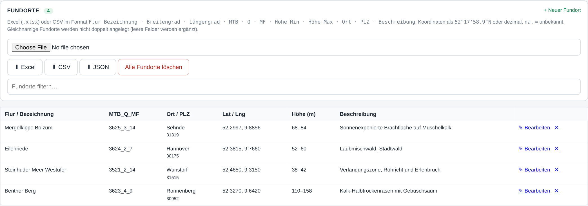

- Tabelle mit Flur/Bezeichnung, **MTB_Q_MF**, Ort/PLZ, Koordinaten, Höhe und Beschreibung.
- **Filter** für schnelles Finden, **Bearbeiten**/**Löschen** pro Zeile, **+ Neuer Fundort**.
- **Import und Export** wie bei den Arten (Excel, CSV, JSON). Beim Import werden Koordinaten in der Schreibweise `52°17'58.9"N` ebenso erkannt wie Dezimalwerte. `na.` steht für *unbekannt*. Gleichnamige Fundorte werden nicht doppelt angelegt, leere Felder werden ergänzt.
- **Alle Fundorte löschen** (mit Sicherheitsabfrage).

#### Fundort bearbeiten / neu anlegen

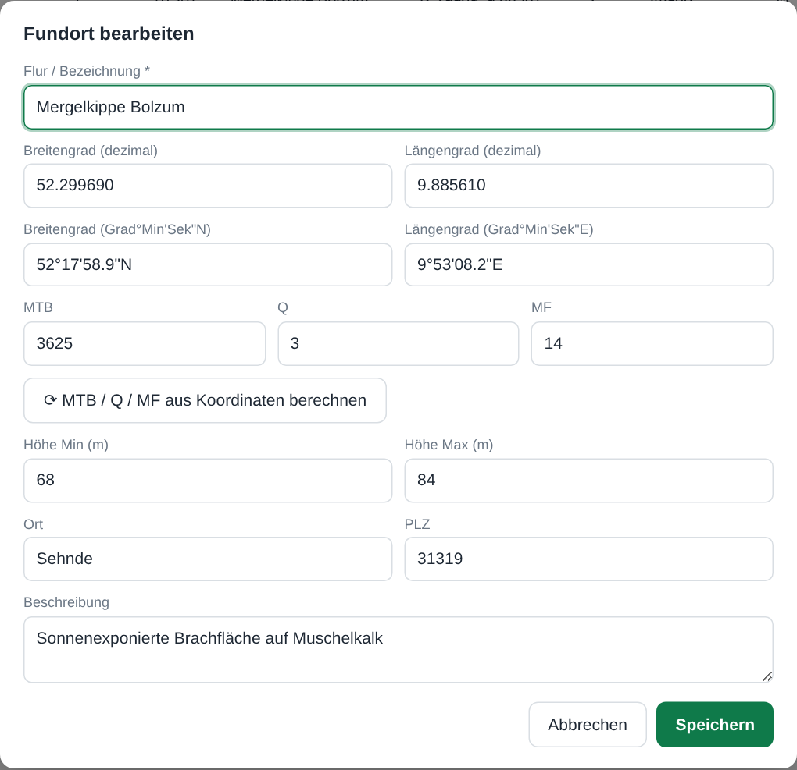

Koordinaten lassen sich **dezimal oder als Grad/Minuten/Sekunden** eingeben. Die Schaltfläche **⟳ MTB / Q / MF aus Koordinaten berechnen** füllt das Rasterfeld automatisch aus.

---

## 3. Funde-Tabelle

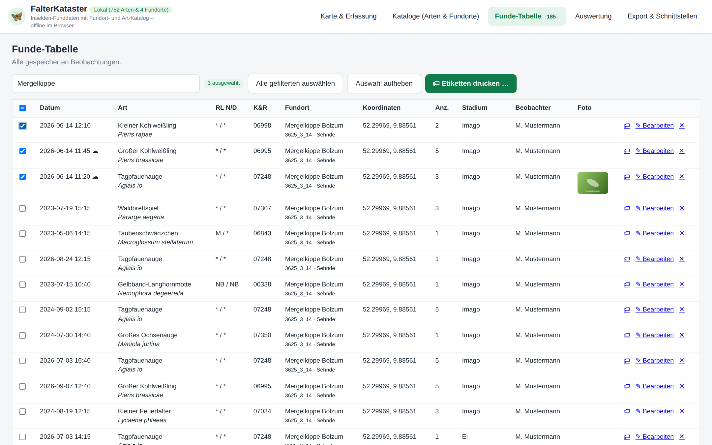

Alle gespeicherten Beobachtungen, neueste zuerst.

- **Spalten:** Datum/Uhrzeit, Art (bei unsicherer Bestimmung inklusive Alternativarten), Rote Liste (N/D), K&R, Fundort (mit MTB_Q_MF und Ort), Koordinaten, Anzahl, Stadium, Beobachter, Foto-Vorschau.
- **☁-Symbol:** Zeigt an, dass Wetterdaten vorliegen. Ein Mouseover blendet sie als Text ein.
- **Filter:** Das Suchfeld durchsucht Art (deutsch und wissenschaftlich), Fundort, Beobachter und Datum.
- **Auswahl:** Über die Kontrollkästchen einzelne Funde markieren, mit **Alle gefilterten auswählen** alle Treffer des aktuellen Filters, mit **Auswahl aufheben** zurücksetzen. Ein Zähler zeigt die Anzahl der gewählten Funde.
- **🏷 Etiketten drucken …** öffnet den [Etikettendialog](#6-sammlungsetiketten-drucken) für die Auswahl. Das 🏷 in einer Zeile druckt direkt das Etikett dieses einen Fundes.
- **Performance:** Angezeigt werden zunächst 300 Zeilen, **Weitere 500 anzeigen** lädt nach. So bleibt die Tabelle auch bei sehr großen Datenbeständen flüssig.

### Fund bearbeiten

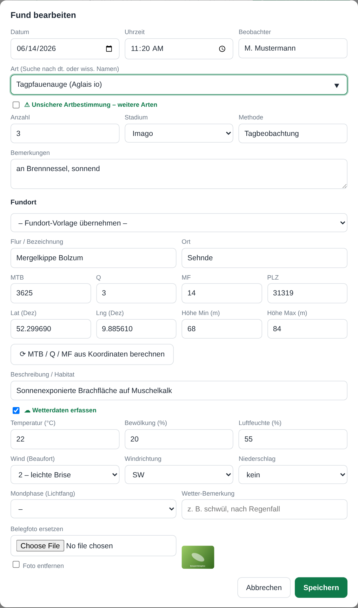

**✎ Bearbeiten** öffnet alle Angaben eines Fundes in einem Dialog:

- Datum, Uhrzeit, Beobachter, Art, unsichere Bestimmung samt Alternativarten
- Anzahl, Stadium, Methode, Bemerkungen
- Fundort: Auswahl einer Vorlage oder direkte Bearbeitung aller Felder samt **MTB-Neuberechnung**
- Wetterdaten ein-/ausschalten und ändern
- **Belegfoto ersetzen** oder **entfernen**

Das **✕** löscht einen Fund nach Rückfrage.

---

## 4. Auswertung

Der Tab **Auswertung** zeigt die Funde auf einer Karte und im Jahresverlauf.

### Filter

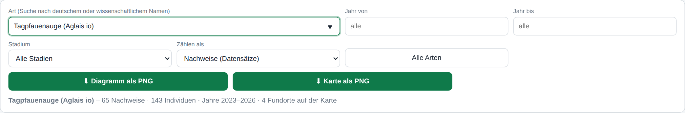

| Filter | Wirkung |
|---|---|
| **Art** | Eine bestimmte Art (Suche nach deutschem oder wissenschaftlichem Namen). Leer oder **Alle Arten** wertet alles aus |
| **Jahr von / bis** | Begrenzt den Zeitraum |
| **Stadium** | Nur ein Entwicklungsstadium oder alle |
| **Zählen als** | *Nachweise (Datensätze)* oder *Individuen (Summe Anzahl)* |

Eine Zusammenfassungszeile nennt die Zahl der Fundorte auf der Karte und weist auf Funde **ohne Koordinaten** oder **ohne gültiges Datum** hin, die nicht darstellbar sind.

Die Auswertung aktualisiert sich bei jeder Änderung sofort.

### Fundkarte

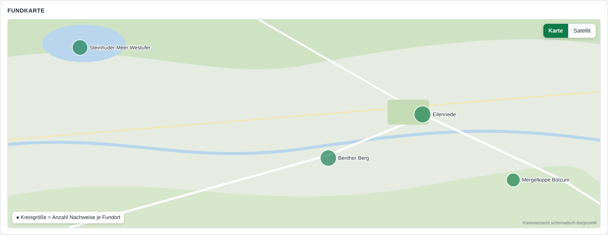

- Pro Fundort ein **Kreis, dessen Größe die Zahl der Nachweise** zeigt.
- **Klick auf einen Kreis:** Fundortname, Nachweise, Individuen, Zahl der Arten und der Zeitraum der Funde.
- Die Karte zoomt automatisch auf alle Fundpunkte, hat einen Maßstabsbalken und den Umschalter Karte/Satellit.
- **⬇ Karte als PNG** speichert die aktuelle Ansicht als Bild.

### Nachweise pro Kalenderwoche

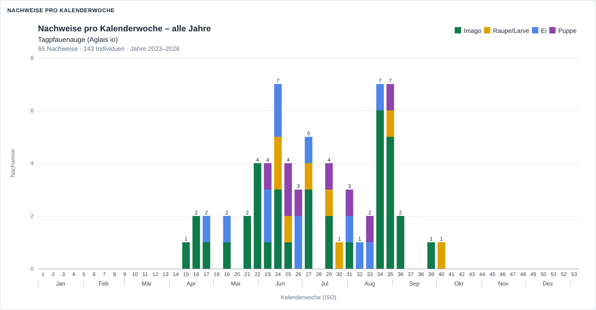

- Balkendiagramm über **alle Jahre**, aufgeteilt auf die ISO-Kalenderwochen 1 bis 53, mit Monatsleiste.
- Die Balken sind **nach Stadium eingefärbt** (Imago grün, Raupe/Larve orange, Ei blau, Puppe violett, Exuvie grau, Fraßspur rot).
- Der Diagrammtitel nennt Art, Zahl der Nachweise und Individuen sowie den Jahresbereich.
- **Mouseover** zeigt die Werte der jeweiligen Woche.
- **⬇ Diagramm als PNG** speichert das Diagramm. Dateinamen enthalten Art und Datum.

Damit lässt sich auf einen Blick erkennen, **wann eine Art im Jahr fliegt** und in welchen Stadien sie nachgewiesen wurde.

---

## 5. Fundbericht (PDF / Word)

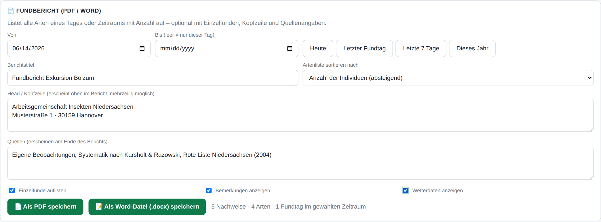

Am Ende des Auswertungs-Tabs erzeugst du einen Bericht über **alle Arten eines Tages oder Zeitraums**.

**Einstellungen**

- **Zeitraum:** *Von* und *Bis*. Bleibt *Bis* leer, gilt nur der eine Tag. Schnellwahl über **Heute**, **Letzter Fundtag**, **Letzte 7 Tage**, **Dieses Jahr**.
- **Berichtstitel**
- **Artenliste sortieren nach:** Anzahl der Individuen (absteigend), wissenschaftlicher Name, deutscher Name oder Systematik (K&R-Nummer)
- **Head / Kopfzeile:** Mehrzeiliger Text oben im Bericht, etwa Verein und Anschrift
- **Quellen:** Text am Ende des Berichts
- **Optionen:** *Einzelfunde auflisten*, *Bemerkungen anzeigen*, *Wetterdaten anzeigen*
- Eine Infozeile zeigt vorab, wie viele Funde der Zeitraum enthält. Titel, Kopfzeile, Quellen und Optionen werden für das nächste Mal gemerkt.

**Ausgabe:** **📄 Als PDF speichern** oder **📝 Als Word-Datei (.docx) speichern**. Beide Formate werden von der Anwendung selbst erzeugt, ohne externe Bibliothek.

### Beispiel: erzeugtes PDF

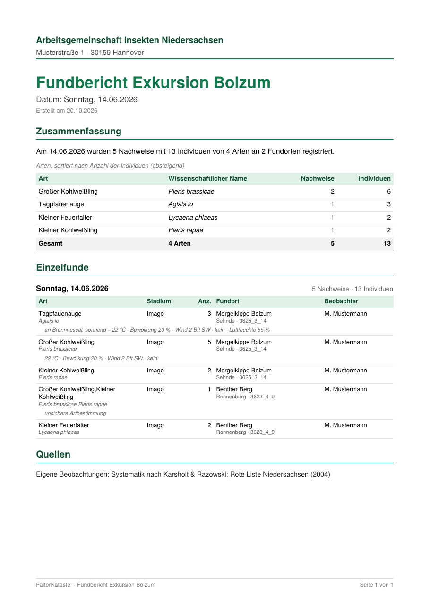

Der Bericht enthält:

1. **Kopfzeile** und **Titel** mit Datum bzw. Zeitraum und Erstellungsdatum
2. **Zusammenfassung** als Satz („… wurden 5 Nachweise mit 13 Individuen von 4 Arten an 2 Fundorten registriert“) und Artentabelle mit Summenzeile
3. **Einzelfunde**, gruppiert nach Tag, mit Stadium, Anzahl, Fundort (inklusive MTB_Q_MF), Beobachter und optional Bemerkung und Wetter
4. **Quellen**
5. **Seitenfuß** mit Seitenzahl, bei Folgeseiten zusätzlich eine Kopfzeile mit Titel und Zeitraum

Bei sehr langen Zeiträumen (über 3000 Nachweise mit Einzelfunden) warnt die Anwendung vor der Seitenzahl, bevor sie den Bericht erstellt.

---

## 6. Sammlungsetiketten drucken

Etiketten für die Insektensammlung entstehen aus ausgewählten Funden. Der Dialog öffnet sich über **🏷 Etiketten drucken …** (Auswahl in der Funde-Tabelle) oder über das 🏷 in einer einzelnen Fundzeile.

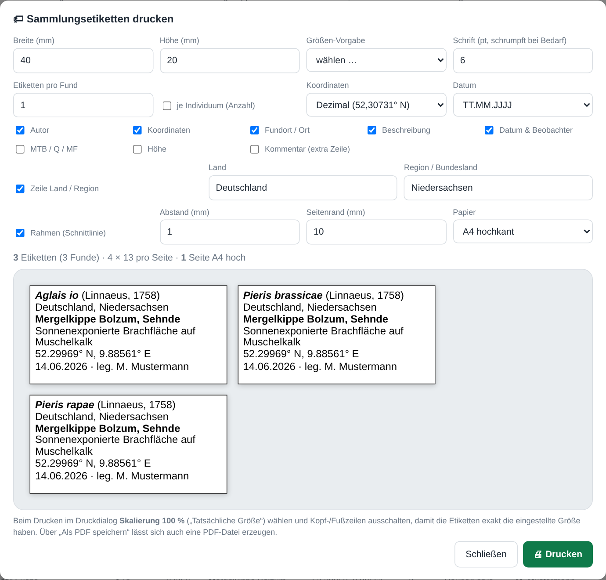

**Format**

- Breite und Höhe in **Millimetern**, dazu **Größen-Vorgaben:** 40 × 20, 30 × 15, 50 × 25, 60 × 30, 70 × 35 mm
- **Schriftgröße in pt.** Die Schrift **schrumpft automatisch**, wenn der Inhalt sonst nicht auf das Etikett passt. Eine Warnung erscheint, wenn der Inhalt auch dann nicht hineinpasst.
- **Papier:** A4 hochkant oder quer, Seitenrand, Abstand zwischen den Etiketten und optional ein **Rahmen** als Schnittlinie

**Anzahl**

- **Etiketten pro Fund** (1–100)
- oder **je Individuum**, dann entspricht die Etikettenzahl der erfassten Anzahl

**Inhalt** (einzeln zuschaltbar)

| Option | Ausgabe |
|---|---|
| Name (immer) | Wissenschaftlicher Name in Kursiv, bei Bedarf mit **Autor** |
| Land / Region | Eigene Zeile mit frei wählbarem Land und Bundesland |
| Fundort / Ort | Flur-Bezeichnung und Ort, fett |
| Beschreibung | Habitat |
| Koordinaten | **Dezimal** (`52.29969° N, 9.88561° E`) oder **Grad° Min' Sek"** |
| MTB / Q / MF | Rasterangabe, wird auch als Ersatz gezeigt, wenn keine Koordinaten vorliegen |
| Höhe | z. B. `68–84 m` |
| Datum & Beobachter | Als `14.06.2026 · leg. M. Mustermann` |
| Kommentar | Bemerkung in eigener Kursivzeile |

**Datumsformate:** `TT.MM.JJJJ`, römischer Monat (`14.VI.2026`, in der Entomologie üblich) oder `JJJJ-MM-TT`.

**Vorschau und Druck**

- Eine **Live-Vorschau** zeigt die Etiketten in Originalgröße. Eine Zusammenfassung nennt Anzahl, Raster pro Seite und benötigte Seiten.
- **🖨 Drucken** öffnet den Druckdialog. Wichtig: **Skalierung 100 % („Tatsächliche Größe“)** wählen und **Kopf-/Fußzeilen ausschalten**, damit die Etiketten exakt die eingestellte Größe haben. Über „Als PDF speichern“ im Druckdialog entsteht eine PDF-Datei.
- Alle Einstellungen werden für das nächste Mal gemerkt.

---

## 7. Export & Schnittstellen

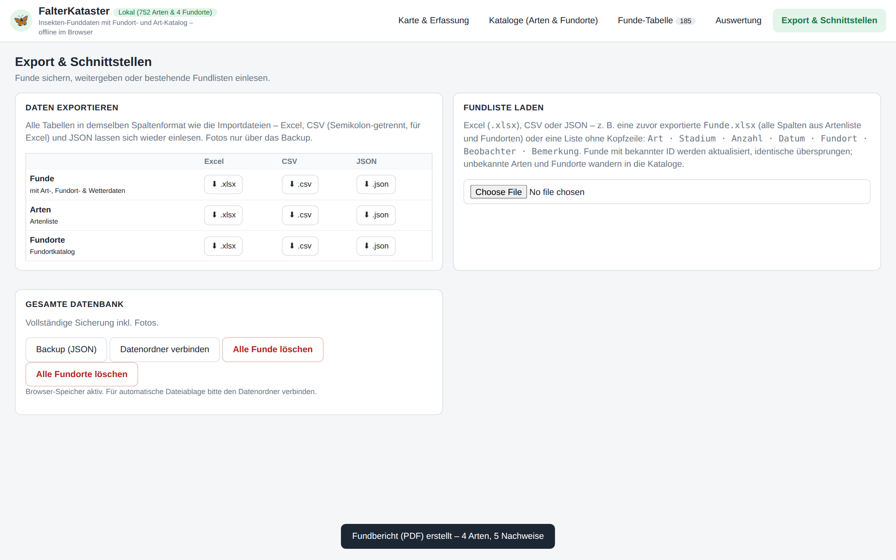

### Daten exportieren

Alle drei Tabellen lassen sich als **Excel (.xlsx)**, **CSV** (Semikolon-getrennt, direkt in Excel nutzbar) und **JSON** exportieren:

| Tabelle | Inhalt |
|---|---|
| **Funde** | Alle Beobachtungen mit zugehörigen Art-, Fundort- und Wetterdaten |
| **Arten** | Die Artenliste |
| **Fundorte** | Der Fundortkatalog |

Das Spaltenformat entspricht den Importdateien, so dass sich **jeder Export wieder einlesen lässt**. Fotos sind nur im Backup enthalten.

### Fundliste laden

Einlesen von Excel, CSV oder JSON, zum Beispiel einer zuvor exportierten `Funde.xlsx` oder einer einfachen Liste ohne Kopfzeile.

- **Funde mit bekannter ID** werden aktualisiert, **identische** übersprungen (kein Doppelimport).
- **Unbekannte Arten und Fundorte** wandern automatisch in die Kataloge.
- Mehrere Arten in einer Zeile (kommagetrennte Gattungs- und Artnamen) werden als **Hauptart plus Alternativarten** eingelesen.

### Gesamte Datenbank

- **Backup (JSON):** Vollständige Sicherung **inklusive Fotos**.
- **Datenordner verbinden:** Verbindet einen Ordner auf der Festplatte. Danach wird jede Änderung automatisch in `falterkataster-datenbank.json` gespeichert. Liegt dort schon eine Datenbankdatei, fragt die Anwendung, ob sie geladen werden soll. Funktioniert in **Edge und Chrome**.
- **Alle Funde löschen** / **Alle Fundorte löschen:** Mit Sicherheitsabfrage.

---

## Datenformate für den Import

### Arten (Excel oder CSV)

Spalten in dieser Reihenfolge:

```
K&R · trivial Name · Überfamilie · Familie · Gattungsname · Artname · Autor · RL NDS · RL NDS 2004 · RL D
```

### Fundorte (Excel oder CSV)

```
Flur Bezeichnung · Breitengrad · Längengrad · MTB · Q · MF · Höhe Min · Höhe Max · Ort · PLZ · Beschreibung
```

Koordinaten als `52°17'58.9"N` oder dezimal. `na.` steht für *unbekannt*. Fehlen MTB, Q und MF, werden sie aus den Koordinaten berechnet.

### Funde (Excel, CSV oder JSON)

Entweder eine **zuvor exportierte Funde-Datei** mit allen Spalten oder eine einfache Liste **ohne Kopfzeile**:

```
Art · Stadium · Anzahl · Datum · Fundort · Beobachter · Bemerkung
```

**Trennzeichen** bei CSV: Semikolon oder Komma werden automatisch erkannt. Bei Excel-Dateien wird das Tabellenblatt mit den meisten Zeilen gelesen, Blätter wie *Hinweis*, *Legende*, *Anleitung*, *Info* oder *Readme* werden übersprungen.

---

## Datenspeicherung & Datensicherheit

| Ebene | Beschreibung |
|---|---|
| **Browser-Speicher (Standard)** | Alle Daten liegen in der **IndexedDB** des Browsers (Datenbank `falterkataster`). Nichts wird an einen Server übertragen |
| **Datenordner (optional)** | Spiegelt die gesamte Datenbank bei jeder Änderung in `falterkataster-datenbank.json` auf der Festplatte |
| **Backup** | Manuelles JSON-Backup inklusive Fotos |
| **Einstellungen** | Kartenmodus (Karte/Satellit) wird im `localStorage` gemerkt, Berichts- und Etiketteneinstellungen in der Datenbank |

> ⚠️ **Wichtig:** Browser-Daten gehen verloren, wenn der Browser-Speicher geleert wird. **Erstelle regelmäßig ein Backup** oder verbinde einen Datenordner.

---

## Technische Hinweise

- **Eine einzige HTML-Datei**, kein Server, keine Installation.
- **Browser:** Aktuelles Edge oder Chrome empfohlen. Die automatische Dateiablage (Datenordner) benötigt die *File System Access API*.
- **Internet wird einmalig bzw. für einzelne Funktionen benötigt:**
  - Karte (Leaflet und Kartenkacheln), Ortssuche und Satellitenbilder
  - Excel-Import und -Export (die Bibliothek SheetJS wird bei Bedarf nachgeladen)
  - Ohne Internet funktionieren Erfassung mit manueller Koordinateneingabe, Kataloge, Funde-Tabelle, Diagramm, Etiketten, PDF/Word-Berichte sowie CSV- und JSON-Import/-Export weiterhin.
- **Verwendete Dienste und Bibliotheken:** [Leaflet](https://leafletjs.com/), [OpenStreetMap](https://www.openstreetmap.org/), [Photon](https://photon.komoot.io/) und Nominatim (Geokodierung), Esri World Imagery (Satellit), [SheetJS](https://sheetjs.com/) (Excel).
- **MTB-Berechnung:** TK25-Raster mit Umrechnung WGS84 → DHDN (Bessel), gültig für Positionen in Deutschland.
- **Sprache:** Deutsch.
